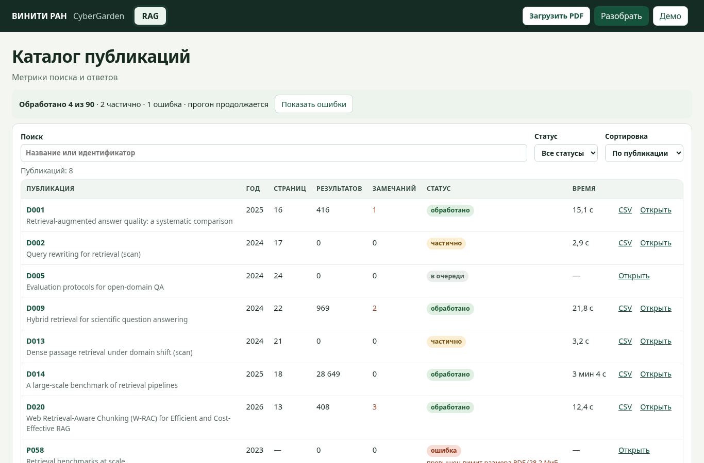
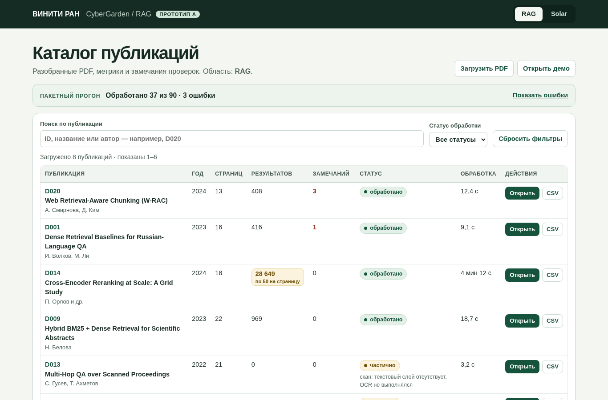
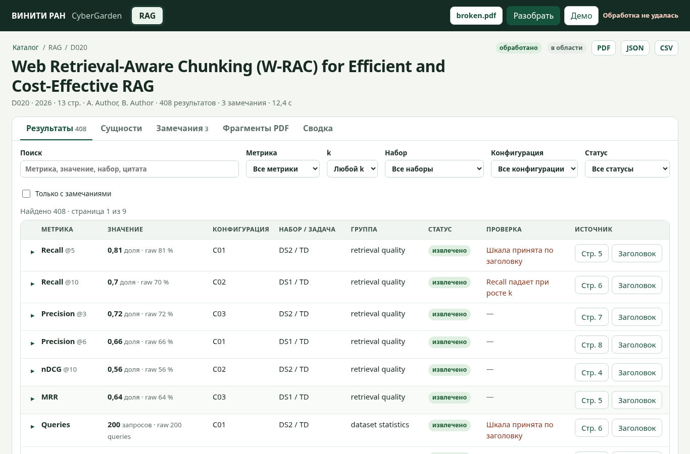
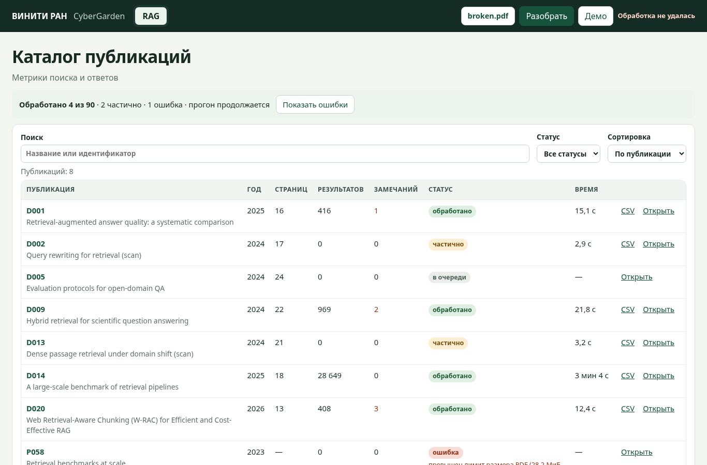
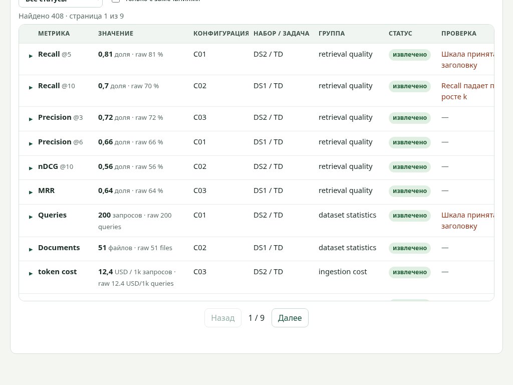
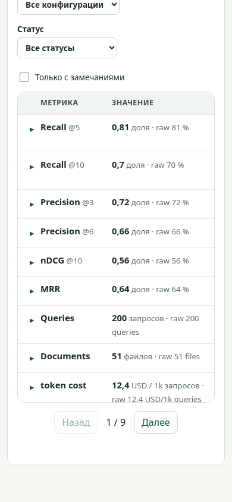
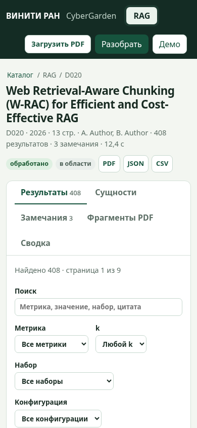
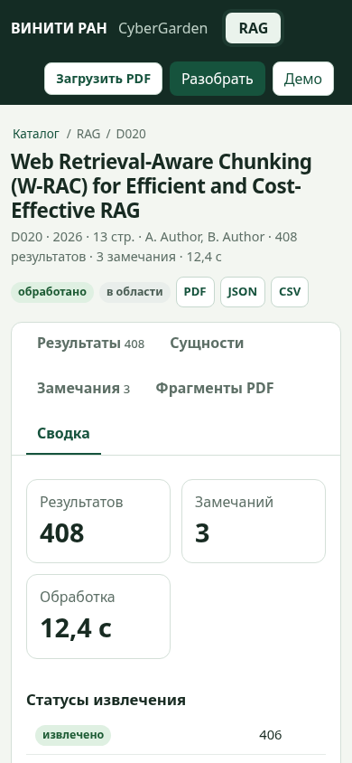
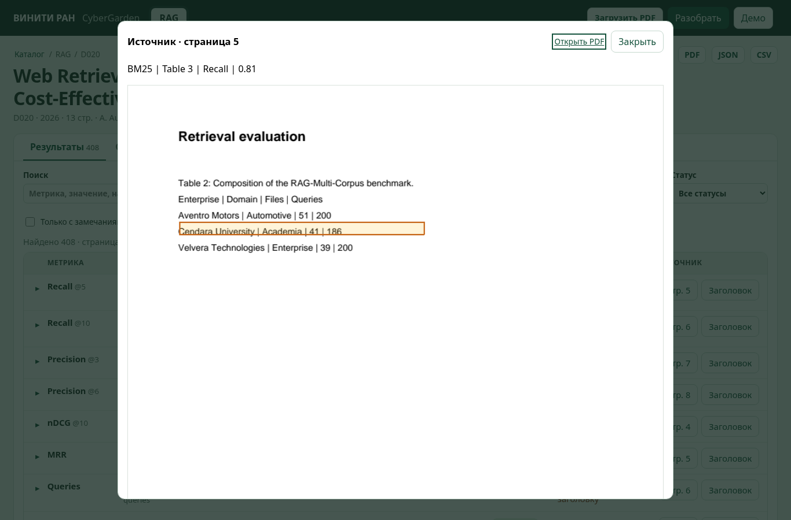
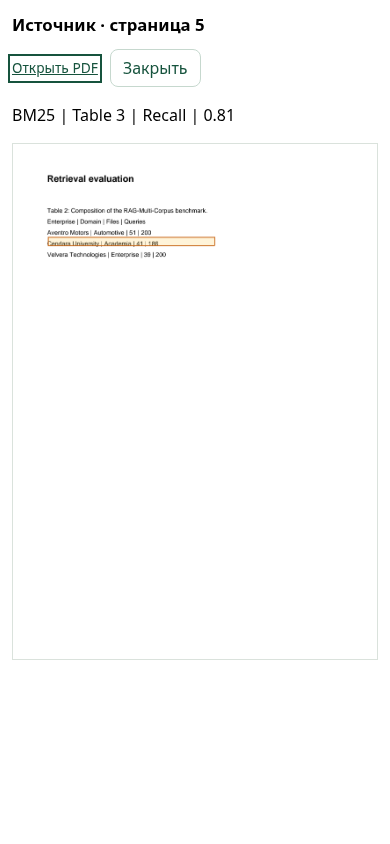

# Дизайн-ревью: каталог научных результатов (RAG, вариант A)

- **Дата:** 2026-11-20
- **Снимок:** рабочее дерево на 20:50 MSK. Во время ревью `static/` активно менялся;
  все находки ниже перепроверены на последней версии, скриншоты сняты с неё.
- **Объект:** `static/index.html`, `static/style.css`, `static/app.js`, `static/catalog.js`,
  `static/document.js`, `static/evidence.js`, `static/ui.js`; сравнение с
  `prototypes/rag-catalog/variant-a.html`
- **Среда:** мок `tools/mock_api.py` (чистый экземпляр на отдельном порту),
  headless Chromium `chromium_headless_shell-1255`, Playwright
- **Разрешения:** 1366×900, 1024×768, 390×844
- **Скриншоты:** `docs/design-reviews/assets/2026-11-20-rag-catalog/`
- **Продакшен-код не менялся**, менялись только документы и скриншоты в `docs/design-reviews/`.

## Вердикт

**Блокеров не выявлено.** Каталог и карточка теперь собраны как в утверждённом варианте A:
белые панели, полные крошки, счётчики вкладок и мета, кнопочные экспорты, sticky-заголовок
таблицы работает, таблицы не рвут слова, диалог доказательства на десктопе читаем.
Основная таблица на 1366, состояния загрузки/пустоты/ошибок и клавиатурная навигация —
в хорошем состоянии.

Оставшиеся проблемы — уровня «до демо»: залипающие сообщения об ошибках при переходах,
горизонтальный скролл, который прячет «Источник» на 1024/390 без всякой подсказки,
мелкое превью доказательства на телефоне и три строки вкладок вместо двух. Это не ломает
основной сценарий, но заметно на защите.

Текущий каталог и референс на 1366:

| Сейчас | Вариант A |
|---|---|
|  |  |

## 🔴 Блокеры

Не обнаружено. Ранее найденные проблемы (неработающий sticky, разрыв слов на 1024/390,
мелкий диалог, отсутствие панели карточки) в текущей версии исправлены; см. раздел
«Что проверено, претензий нет».

## 🟡 Важное

### Q1. Ошибки «залипают» при переходах; у ошибки загрузки документа нет заголовка

- **Где:** `static/app.js:53-56` (`say()`), `:99-174` (`route()` не очищает статус),
  `:165-173` (глобальная ошибка документа), `:176-192` (`busy()` пишет ошибку в два
  live-region); `static/index.html:22,28` (`#uploadState` и `#status` с `role="status"`).
- **Что видно:**
  - открыть `#/doc/rag:missing?track=rag`, затем нажать бренд «ВИНИТИ РАН» → в каталоге
    снизу остаётся красное «Документ не найден.» (`desk-status-leak.png`);
  - после ошибки загрузки открыть валидную D020 → в шапке остаётся «Обработка не удалась»,
    а снизу — красная строка (`desk-upload-error-leak.png`);
  - открыть несуществующий якорь `#/doc/rag:d020/source/99999`, затем вернуться в каталог
    → «Не удалось открыть источник…» остаётся на здоровой странице
    (`desk-source-error-leak.png`);
  - на странице «Документ не найден» (`desk-doc-error.png`) ошибка дублируется в
    `#status`, а в разметке ошибки нет `h1` — заголовок `strong`; `document.title`
    остаётся «ВИНИТИ · Каталог результатов».

  
  
  
- **Чем плохо:** пользователь видит ложную ошибку на исправной странице; при возврате
  назад/переходе по бренду непонятно, к чему относится сообщение. Два `role="status"`
  (`#uploadState` + `#status`) с одним и тем же текстом дают двойное объявление
  скринридером.
- **Что сделать:** очищать `#status`/`#uploadState` при старте успешного маршрута (не
  трогая активную загрузку) и после `busy()` при навигации; не дублировать одну ошибку
  в двух live-region — оставить один видимый inline-блок/тост; на экране ошибки
  документа поставить `h1` и обновить `document.title` (`role="alert"` у notice уже есть).

### Q2. На 1024 и 390 горизонтальный скролл прячет «Источник» без подсказки

- **Где:** `static/style.css:115-124` (`min-width` таблиц), `:169-174` (кнопки экспорта),
  `static/document.js:400-412` (`colgroup`, фиксированные ширины).
- **Что видно:** таблица результатов имеет ширину **1173px**. При 1024 контейнер
  **948px**, колонка «Источник» начинается на `x=1031` при правой границе контейнера
  `987` — кнопки «Стр. N»/«Заголовок» полностью вне экрана (`mid-results-table.png`).
  При 390 контейнер **330px**: видны только «Метрика» и «Значение», остальные шесть
  колонок и действия — за кадром (`mob-results-table.png`). У `.results` есть
  `overflow:auto`, но нет ни видимого скроллбара, ни градиента/подсказки; на телефоне
  таблица выглядит обрезанной.
- **Чем плохо:** «Источник» — главный affordance доказательства. На типовом ноутбуке
  1024 его не видно, пока пользователь не догадается про горизонтальный скролл; на
  телефоне не видно ни проверки, ни источника.

  
  
- **Что сделать:** на 1024 ужать второстепенные колонки (группа/проверка) или закрепить
  «Источник» справа / первую колонку слева; добавить у правого края градиент/тень и
  короткую подсказку «Прокрутите таблицу»; на мобильном вынести действия источника в
  раскрытую строку/карточку. Проверить, что Tab доводит фокус до скрытых кнопок и
  контейнер автоматически прокручивается.

### Q3. Мобильные вкладки занимают три строки вместо двух

- **Где:** `static/style.css:246-258` — `.tabs { flex-wrap: wrap; overflow: visible; }`
  в сочетании с `:183` (`.tab[data-count]::after`).
- **Что видно:** на 390 вкладки начинаются на `y=357, 407, 457` — **три ряда**:
  «Результаты 408 / Сущности», «Замечания 3 / Фрагменты PDF», «Сводка»
  (`mob-doc-results.png`, `mob-doc-summary.png`). В брифе ожидались две строки.

  
  
- **Чем плохо:** высокий блок вкладок отодвигает фильтры и таблицу вниз; на экране
  844px до данных остаётся меньше места, а карточка выглядит менее собранной.
- **Что сделать:** на ≤760px скрыть счётчики вкладок (`.tab[data-count]::after`), уменшить
  горизонтальные отступы/шрифт или перейти на горизонтальный tab-strip с одним рядом;
  проверить, что активная вкладка и стрелки при этом остаются доступными.

### Q4. На телефоне превью доказательства всё ещё нечитаемо

- **Где:** `static/style.css:226-253` (`dialog`, `img { width:100% }`, full-screen на
  ≤760), `static/evidence.js:58-66`.
- **Что видно:** на 1366 изображение 926px шириной и текст читается
  (`desk-evidence.png`); на 390 диалог full-screen, но изображение **366×517px**, текст
  страницы ≈6px (`mob-evidence.png`). Подсветка — тонкая рамка, содержимое таблицы
  разобрать нельзя. Кнопка «Открыть PDF» есть — это хороший fallback, но собственная
  ценность превью на мобильном теряется.

  
  
- **Чем плохо:** сценарий «проверить цитату/ячейку по картинке» на телефоне не работает:
  приходится уходить в PDF и терять контекст.
- **Что сделать:** отдавать кроп вокруг `bbox` в 2–3× (дешевле полной страницы) и/или
  добавить зум/панорамирование (pinch или кнопки) с явным индикатором масштаба. Полный
  PNG можно оставить вкладкой/кнопкой «Вся страница»; «Открыть PDF» сохранить.

### Q5. Небольшие зоны нажатия на мобильном

- **Где:** `static/style.css:145-150` (`.actions a`, `.expander button`), `:169-174`
  (`doc-actions a`), `static/index.html:17` (файловая кнопка).
- **Что видно (390, замеры):** раскрыватель строки **28×28**, кнопки «Стр. N» **55×30**,
  «Заголовок» **84×30**, PDF/JSON/CSV — **43×34 / 51×34 / 42×34**, файловая кнопка
  **216×35,6**. Это проходит минимум WCAG 2.2 AA (24×24), но заметно ниже 44×44,
  особенно раскрыватель.
- **Чем плохо:** на телефоне сложно попасть в раскрыватель и кнопки источника; ошибки
  касания раздражают при просмотре плотной таблицы.
- **Что сделать:** довести основные touch-цели до 40–44px (padding/минимальная высота),
  в первую очередь `.expander button` и кнопки источника; на десктопе можно оставить
  компактными.

## ⚪️ Улучшения

- **Дублирование пустого состояния.** В каталоге при `Публикаций: 0` кнопка
  «Сбросить фильтры» есть и в панели фильтров, и в самом пустом состоянии
  (`catalog.js:78` и `:227`; `desk-catalog-empty.png`). Оставить одну, предпочтительно
  в empty-state рядом с объяснением.
- **Двойное live-объявление при загрузке.** `#uploadState` и `#status` оба имеют
  `role="status"`; `busy()` пишет один текст в оба (`index.html:22,28`,
  `app.js:182-186`). Скринридер может прочитать сообщение дважды; оставить один
  live-region или явно разделить роли (визуальный статус vs. объявление).
- **Скан без текста.** На D013 (`desk-scan.png`) после единственного корректного
  уведомления всё ещё показываются «Поиск» и «Только с замечаниями», хотя искать
  нечего. Для скана лучше оставить только «Фрагменты PDF»/PDF и убрать фильтры
  результатов.
- **Ноль результатов в мета-строке очереди/ошибки.** Для `queued`/`failed`
  («Evaluation protocols…», `desk-queued-doc.png`) в мете стоят «0 результатов ·
  0 замечаний», что читается как «данных нет», хотя обработка ещё не начиналась или
  упала. Лучше «— результатов» или опускать счётчики до завершения.
- **Экран ошибки документа.** Кроме отсутствующего `h1` (Q1), у ошибки нет своего
  контейнера/иконки, как у пустых состояний; `.notice` прижат к верху страницы
  (`desk-doc-error.png`). Стоит использовать тот же empty/error-шаблон, что и для
  «Раздел не подключён».
- **`aria-busy` и скелетоны.** В состоянии загрузки показывается только «Загрузка…»,
  без `aria-busy` и скелетона (`desk-loading-results.png`). Для 50 строк это не
  критично, но после переключения фильтра полезно сохранить визуальную структуру.
- **Скролл после пагинации.** Сейчас после «Далее» страница прокручивается к таблице
  и фокус ставится на счётчик — это работает (`desk-page2.png`), но `scrollIntoView`
  использует `behavior: "smooth"` без учёта `prefers-reduced-motion`. Добавить
  проверку или `behavior:"auto"` при reduced motion.
- **Длинный диалог.** На 1366 изображение выше окна и заголовок с «Открыть PDF»/
  «Закрыть» уезжает при прокрутке внутри диалога; для длинных страниц лучше sticky
  header диалога. На мобильном заголовок уже закреплён сверху по макету.
- **Точки входа и заголовки.** У `<dialog>` заголовок теперь `h2` — хорошо; на экране
  глобальной ошибки документа заголовка нет. У `<nav class="crumbs">` текущий документ
  — `span`, без `aria-current="page"`; для скринридера можно добавить.
- **Мелочи стилей.** В `style.css` всё ещё много повторов: `#c6d8ce` (строки 50, 69, 77,
  168, 230), `#3c5148` (128), `#eaf3ec` (43, 57), `#8d381d` (221-222). В `:root` только
  пять токенов. Стоит вынести border/danger/focus-soft в переменные, особенно перед
  подключением Solar.

## Согласованность с вариантом A

| Элемент | Сейчас | Вариант A | Итог |
|---|---|---|---|
| Каталог | белая панель с фильтрами и таблицей | белая панель | совпадает |
| Карточка | белая панель, шапка + вкладки + panel | то же | совпадает |
| Крошки | `Каталог / RAG / D020` | `Каталог / RAG / D020` | совпадает |
| Мета | ID, год, страниц, авторы, результаты, замечания, время | то же | совпадает |
| Вкладки | с счётчиками | с счётчиками | на 390 три ряда вместо двух |
| Экспорты | ghost-кнопки PDF/JSON/CSV | ghost-кнопки | совпадает |
| Статус/область | зелёный статус + нейтральная «в области» | статус с точкой, без бейджа scope | допустимое отличие |
| Таблица результатов | fixed layout, 1173px, sticky | min-width 1010px | на 1366 ок; на 1024/390 нужен scroll-индикатор |
| Доказательство | 960px, одна колонка, крупный PNG | 980px, две колонки, крупная имитация | десктоп читаем; мобайл требует кропа |
| Пустые состояния | панель + CTA; на мобильном empty перед фильтрами | отдельный блок с dashed-рамкой | структурно совпадает |

Палитра, радиусы (8/10/12), статусы, типографика и плотность таблиц теперь узнаваемо
принадлежат одному продукту. Главное расхождение — мобильная раскладка вкладок и
поведение широкой таблицы, а не общий стиль.

## Что проверено, претензий нет

- **Sticky-заголовок.** В `.results` (`max-height: min(72vh,720px)`) при `scrollTop=700`
  верх `th` остаётся на `436.8px`; после прокрутки видны и заголовки, и строки
  (`desk-results-scrolled.png`). На 390 sticky работает внутри 62vh-контейнера.
- **1366, 8 колонок.** Таблица занимает 1284px в контейнере 1284px; строки 55–63px;
  длинные значения переносятся, а не рвутся; кнопки источника стоят в одну строку.
  Длинные названия публикаций и заголовок карточки переносятся без обрезки.
- **Стабильные колонки.** `<colgroup>` + `table-layout: fixed`; страница 2 сохраняет
  ширины, пагинация не «прыгает» (`desk-page2.png`). После «Далее» страница
  прокручивается к таблице, фокус на счётчике.
- **Контраст.** `muted` `#5d6f66` на `#f3f6f1` — **4.90**; на белом — 5.34; шапки таблиц
  — 7.75; `badge.ok` — 6.81; `badge.warn` — 6.00; `badge.bad` — 6.38; `badge.idle` — 5.81;
  `#uploadState` — 10.8; focus-ring на тёмной шапке (`#eaf3ec` на `#142c24`) — **13.09**.
  Все основные текстовые пары проходят AA.
- **Фокус и клавиатура.** Первый Tab после загрузки идёт на «К содержанию»
  (`TABORDER` = `A:К содержанию, A:ВИНИТИ РАН…, BUTTON:RAG, INPUT`); skip-link
  возвращает фокус в `#view`. На тёмной шапке видимое светлое кольцо
  (`desk-focus-demo.png`). Стрелки/Enter/клик по вкладкам сохраняют фокус на активной
  вкладке; `role=tablist/tab/tabpanel`, `aria-selected`, `aria-controls` на месте.
- **Семантика.** У таблиц есть `caption`, `th scope`, у панели вкладок — скрытый `h2`,
  у диалога — `h2`; `aria-live` счётчики сообщают «Найдено 0» и пустое состояние.
- **Диалог.** Esc, «Закрыть» и Back закрывают; URL возвращается от
  `#/doc/rag:d020/source/1001` к `#/doc/rag:d020?track=rag`; фокус при открытии — на
  первой ссылке/кнопке, при закрытии из таблицы возвращается на «Стр. 5». Fallback без
  картинки работает (`desk-noimage.png`); deep link открывает диалог.
- **Загрузка PDF.** После выбора видно имя файла (с ellipsis), кнопка «Разобрать»
  блокируется вместе с формой, «Обработка PDF…» появляется в шапке (`mob-upload-busy.png`);
  ошибка сервера подсвечивается в `#uploadState` (`desk-upload-error.png`). Клик без
  файла даёт «Сначала выберите PDF».
- **Состояния.** Loading (`desk-loading-results.png`), пустой каталог (без клиппинга),
  пустой результат, сетевой сбой с «Повторить» и `role="alert"`, скан без OCR,
  частичная обработка (одно уведомление вместо дубля), очередь, failed, «только с
  замечаниями» — все визуально различимы.
- **Мобильная сетка.** `documentElement.scrollWidth = 390`, то есть широкие таблицы
  не создают горизонтальный скролл страницы; таблица результатов скроллится внутри
  `.results` (330×1173), каталог — внутри своей панели. Вкладки и фильтры не ломают
  страницу.
- **Форматы.** Числа с пробелами (`28 649`), длительности (`3 мин 4 с`), «Все метрики /
  Любой k / Все наборы» вместо одинаковых «Все», `document.title` обновляется на
  каталоге и карточке.

## Что не проверено и почему

- **Реальные браузеры.** Только headless Chromium; Firefox/Safari, iOS/Android touch,
  pinch-zoom и overscroll не проверены. Поведение `dialog` при Back может отличаться.
- **Скринридеры и 200% zoom.** Разметку, фокус и контраст проверил, но VoiceOver/NVDA
  и реальное увеличение 200% не запускал; ADR-0008 это требует.
- **Solar.** Дескриптора и фикстур нет — проверено только состояние
  `#/?track=solar`; переключение областей, сохранение фильтров и `X-Track` не проверить.
- **Реальный backend и объём 90 PDF.** Мок отдаёт 8 документов каталога; вторая страница
  каталога и sticky на длинном каталоге не воспроизводимы. Для результатов проверена
  только страница 2 из 9.
- **Реальные PDF.** Мок всегда отдаёт одну синтетическую страницу с одинаковым `bbox`.
  Q4 про мобильную читаемость — вывод по геометрии и синтетическому превью; реальные
  таблицы/сканы могут быть хуже.
- **Частичная обработка с данными.** В фикстурах `partial` — только скан с 0 результатов;
  состояние «часть страниц разобрана, часть результатов есть» не проверено.
- **Долгая загрузка/обрыв.** Эмулировал задержку и 500, но не проверял отмену, таймауты
  и очень большой PDF.
- **Печать, RTL, тёмная тема.** Вне объёма; тёмной темы в продукте нет.

## Приоритет исправлений

1. Q1 — очищать ошибки при навигации, один live-region, `h1`/title для ошибки документа.
2. Q2 — сделать «Источник» и действия доступными на 1024/390 (pin/fade/скрытие
   второстепенных колонок).
3. Q4 — кроп/зум доказательства на телефоне.
4. Q3 — вернуть вкладки к двум строкам на 390.
5. Q5 и ⚪️ — увеличить touch-цели, убрать дублирующиеся CTA, поправить мелочи
   состояний.
